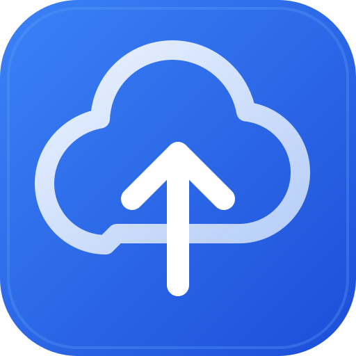
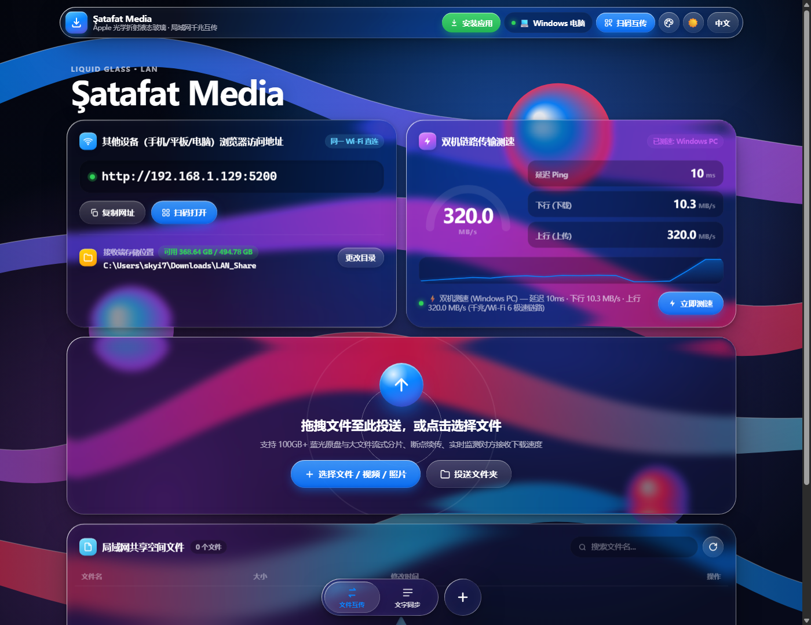
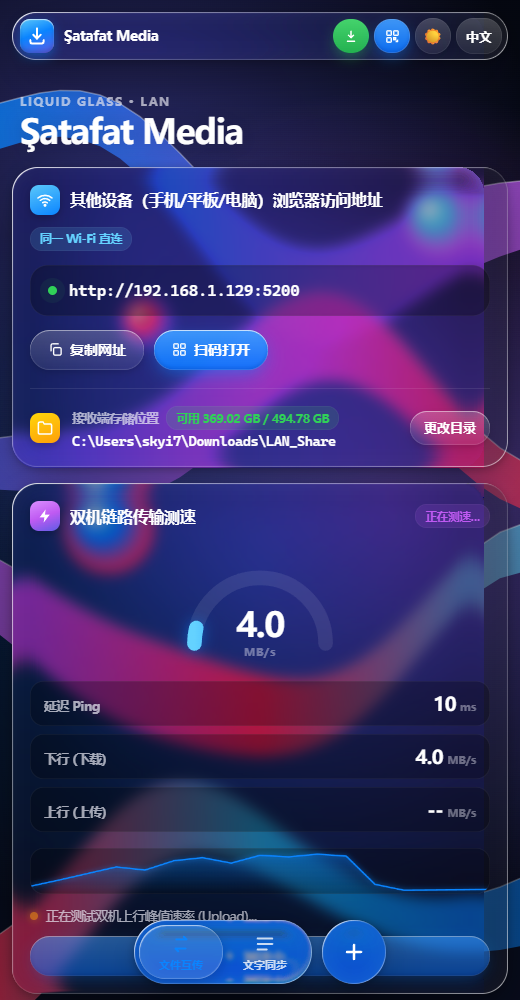

<div align="center">



# Şatafat Media

### Apple Liquid Glass 光学折射 · 局域网千兆大文件极速互传
### Apple Liquid Glass Optical UI · Gigabit LAN Large File Transfer

[](#)
[](#)
[](#)
[](#)

**[🇨🇳 中文说明](#-中文介绍-chinese) · [🇬🇧 English Documentation](#-english-documentation) · [📸 应用截图 / Screenshots](#-应用截图--app-screenshots) · [🚀 一键启动 / Quick Start](#-一键启动指南--quick-start)**

</div>

---

## 📸 应用截图 / App Screenshots

### 💻 桌面端（Apple Liquid Glass 光学透镜折射界面 / Desktop UI）


### 📱 移动端（iOS / Android 自适应液态玻璃与悬浮胶囊导航 / Mobile UI）
<div align="center">
  
</div>

---

## 🇨🇳 中文介绍 (Chinese)

**Şatafat Media** 是一款零配置、免安装、开箱即用的**局域网千兆大文件互传与双机链路测速工具**。
前端完整复刻 **Apple iOS 26 / macOS Tahoe「液态玻璃 (Liquid Glass)」实时 SVG 光学折射引擎**，后端提供原生编译的 **一键启动 `SatafatMedia.exe`（仅 33KB，Windows 零依赖直接双击运行）** 以及跨平台 Go 引擎，支持电脑、iPhone (Safari)、iPad、Android 手机在同一 Wi-Fi / 局域网下跑满物理带宽。

### ✨ 核心亮点

1. **🔮 Apple iOS 26 / macOS Tahoe 原生级「液态玻璃 (Liquid Glass)」光学界面**
   - **真实 SVG 凸透镜折射 (`feDisplacementMap`)**：基于圆角有向距离场 (SDF) 与 Snell 折射定律动态生成法线位移贴图，当页面滚动或色带流光经过卡片边缘时，背景像素在玻璃弧面边缘产生真实的物理弯曲与放大折射。
   - **RGB 色散棱镜效应 (Chromatic Dispersion)**：将 R / G / B 三通道分离并以不同折射强度采样，在玻璃边缘呈现微妙的晶莹棱镜色散光晕。
   - **双层对角镜面高光环 (Specular Meniscus Rim)** 与鼠标/触控实时动态反光追踪。
   - **iOS 26 悬浮液态胶囊 Dock 栏**：切换底部标签时，液态水滴滑块呈现弹性拉伸形变 (`cubic-bezier(0.32, 0.72, 0, 1)`)。
   - **4 套动态流光丝带主题 + 深浅色模式 + 中/英/土三语切换**。

2. **⚡ 扫码连接即自动触发「双机链路传输测速」**
   - 手机或另一台电脑扫码进入页面后，自动执行 **Ping 延迟探测 + 下行 (Download) 峰值测速 + 上行 (Upload) 峰值测速**。
   - 测速结果通过 `/api/speedtest/report` 实时回传并同步显示在主机端与手机端的 240° 环形仪表盘与速率波形图上，直观评估当前 Wi-Fi / 网线物理极限。

3. **📡 接收方下载速度实时监测（主机端双向可见）**
   - 当其他设备从共享空间下载文件时，服务端流式追踪每个 socket 数据块的实时吞吐率（MB/s）、已传字节数与客户端设备型号，并在**发送端和接收端界面同步展示实时接收下载速度面板**。

4. **📦 100GB+ 蓝光原盘级大文件分片流式传输与断点续传**
   - 采用 16MB 动态分片 + 多并发通道流水线上传，无视浏览器内存限制。
   - 支持 HTTP `Range (206 Partial Content)` 断点续传与 iOS Safari 防息屏 (`WakeLock`) 保持。

5. **📁 接收端自定义下载/存储文件夹**
   - 主机端可随时在网页上一键调用原生文件夹选择器更改接收与共享目录，自动持久化至 `config.json`，并实时展示目标磁盘剩余可用空间。

6. **📋 跨设备剪贴板文字/链接秒同步**
   - 手机复制验证码、长链接或代码片段，一键推送至电脑剪贴板，多端实时共享。

---

### 🚀 一键启动指南 (Quick Start)

#### 方式一：双击一键启动 `.exe`（推荐，Windows 免安装零依赖）
仓库根目录已内置编译好的原生可执行程序：
- 双击 **`一键启动-SatafatMedia.exe`** 或 **`SatafatMedia.exe`**
- 程序将自动探测局域网 IPv4 地址、启动高并发传输引擎，并在默认浏览器打开控制台页面。
- 其他设备（手机/平板/电脑）只需连接同一 Wi-Fi，用相机扫描页面上的二维码，或在浏览器直接输入顶部高亮显示的 `http://<局域网IP>:5200` 即可互传！

#### 方式二：使用批处理或 PowerShell 脚本启动
```powershell
# 双击运行 start.bat，或在 PowerShell 中执行：
.\server.ps1
```

#### 方式三：从源码重新编译 `.exe`（使用 Windows 自带 .NET 编译器）
```powershell
C:\Windows\Microsoft.NET\Framework64\v4.0.30319\csc.exe /target:exe /out:SatafatMedia.exe /reference:System.Web.Extensions.dll /optimize+ LanServer.cs
```

#### 方式四：跨平台 Go 引擎（macOS / Linux / Windows）
```bash
go run server.go
# 或编译为跨平台二进制可执行文件：
go build -o satafat-media server.go
```

---

## 🇬🇧 English Documentation

**Şatafat Media** is a zero-configuration, dependency-free **Gigabit LAN Large File Transfer & Dual-Device Link Speed Benchmark suite**.
Featuring a custom **Apple iOS 26 / macOS Tahoe Liquid Glass real-time SVG optical refraction engine** on the frontend and a native **one-click Windows executable (`SatafatMedia.exe`, only 33 KB)** plus a cross-platform Go backend, it enables effortless multi-gigabyte file sharing between Windows, Mac, iPhone (Safari), iPad, and Android devices over local Wi-Fi or Ethernet.

### ✨ Key Features

1. **🔮 Apple iOS 26 / macOS Tahoe Optical Liquid Glass UI**
   - **Real-Time SVG Convex-Lens Refraction (`feDisplacementMap`)**: Generates per-element Signed Distance Field (SDF) normal displacement maps based on Snell's Law, bending and refracting background light ribbons along curved glass bezels as you scroll or resize.
   - **RGB Chromatic Dispersion**: Separates R, G, and B channels at slightly different refractive indices for authentic crystal edge dispersion.
   - **Dual-Layer Specular Meniscus Rim & Pointer Glare**: Dynamic diagonal rim lighting and interactive cursor/touch glare tracking.
   - **iOS 26 Floating Pill Dock**: Morphing liquid droplet indicator with spring stretch physics (`cubic-bezier(0.32, 0.72, 0, 1)`).
   - **4 Wallpaper Ribbon Presets + Dark/Light Mode + Trilingual UI (`中文` / `English` / `Türkçe`)**.

2. **⚡ Automatic Post-Scan Dual-Device Link Speed Test**
   - As soon as a peer device scans the QR code or opens the LAN URL, Şatafat Media automatically benchmarks **Ping Latency + Download Throughput + Upload Throughput** using high-speed non-compressible memory streams (`/api/speedtest/*`).
   - Results are synchronized back to the host via `/api/speedtest/report` so both devices see the live 240° gauge and throughput sparkline.

3. **📡 Real-Time Receiver Download Speed Detection**
   - When any peer downloads a file from the shared space, the server measures live socket chunk throughput (`MB/s`), progress percentage, and client device type via `/api/transfers`, displaying a live **Receiver Download Telemetry** monitor on both the sender and receiver screens.

4. **📦 100GB+ Chunked File Streaming & Breakpoint Resume**
   - 16 MB chunked streaming upload pipeline bypasses browser memory limits.
   - Full HTTP `206 Partial Content` (`Range`) support for resumable downloads and iOS Safari `WakeLock` keep-awake protection.

5. **📁 Custom Receiver Storage Folder**
   - Choose any local folder or drive where incoming files should be saved directly from the web UI (via native folder picker or path input), persisted in `config.json` with live free-disk-space telemetry.

6. **📋 Instant Cross-Device Text & Clipboard Sync**
   - Send links, verification codes, or notes between phone and PC in one tap.

---

### 🛠️ Quick Start (English)

1. **One-Click Windows `.exe` (Recommended)**:
   - Double-click **`SatafatMedia.exe`** (or **`一键启动-SatafatMedia.exe`**).
   - The server starts automatically on port `5200` (or the next free port) and opens `http://localhost:5200` in your browser.
   - On your phone, tablet, or another computer connected to the same Wi-Fi, scan the QR code or enter the displayed LAN URL (`http://<LAN-IP>:5200`) in any browser.
2. **Script Launchers**:
   - Double-click `start.bat` or run `.\server.ps1` in PowerShell.
3. **macOS / Linux (Go Backend)**:
   - Run `go run server.go` to launch the cross-platform server.

---

## 📂 Project Structure / 项目目录结构

```text
satafat-media/
├── SatafatMedia.exe            # 🚀 One-click native Windows executable (双击一键启动程序)
├── 一键启动-SatafatMedia.exe    # 🚀 Chinese-named one-click launcher (中文名一键启动程序)
├── start.bat                   # Windows batch launcher (批处理启动器)
├── server.ps1                  # PowerShell launcher script (PowerShell 启动脚本)
├── LanServer.cs                # C# multithreaded HTTP & streaming core engine (C# 核心源码)
├── server.go                   # Cross-platform Go HTTP server engine (跨平台 Go 服务端源码)
├── screenshots/                # Application UI screenshots (应用界面截图)
│   ├── desktop-liquid-glass.png
│   └── compact-liquid-glass.png
└── web/                        # Apple Liquid Glass Frontend (前端静态资源)
    ├── index.html              # Responsive Bento layout & floating dock
    ├── style.css               # Optical Liquid Glass CSS & theme variables
    ├── liquid-glass.js         # Real-time SVG SDF convex-lens displacement engine
    ├── app.js                  # Chunked transfer, speedtest, receiver telemetry & i18n
    ├── qrcode.min.js           # Offline LAN QR Code generator
    ├── sw.js                   # PWA Service Worker
    └── manifest.json           # Web App Manifest
```

---

## 📄 License

Released under the [MIT License](LICENSE).
